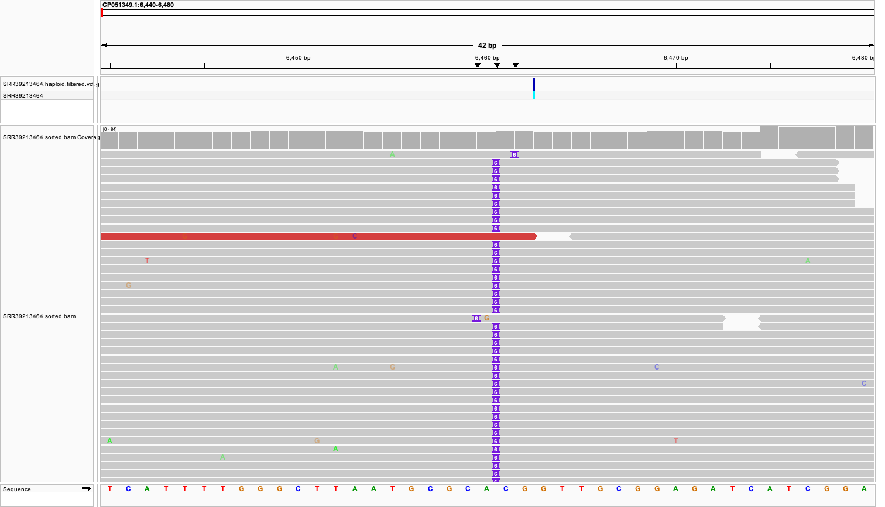
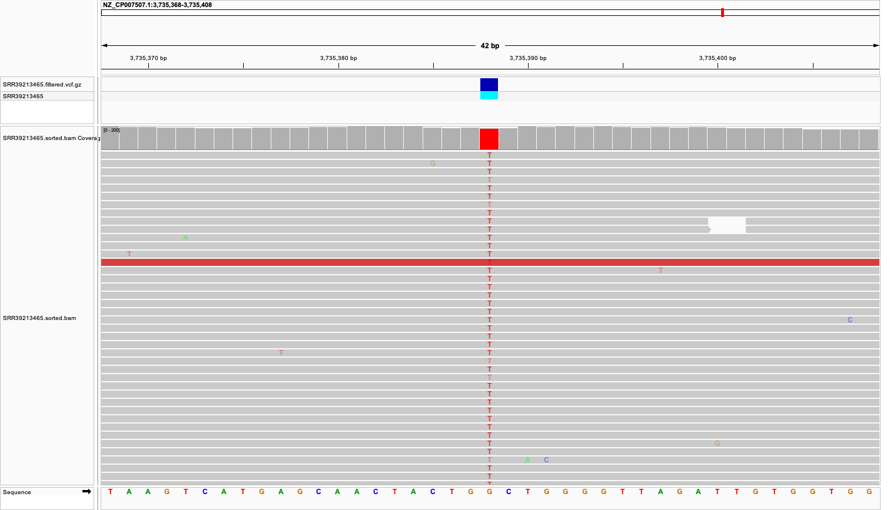

# Bacterial Whole-Genome Sequencing (WGS) Analysis

## Project Overview

This project demonstrates an end-to-end bacterial whole-genome sequencing (WGS) analysis workflow, from raw paired-end sequencing reads to variant identification and visualization.

Two publicly available sequencing datasets were analyzed using quality-control, read preprocessing, reference-based alignment, and variant-calling tools.

The analysis focuses on two bacterial reference organisms:

- *Salmonella enterica* serovar Enteritidis — SRR39213465
- *Salmonella enterica* serovar Bovismorbificans — SRR39213464

## Project Objectives

The main objectives of this project are to:

1. Assess the quality of raw Illumina paired-end sequencing reads.
2. Perform read filtering and trimming to improve sequencing data quality.
3. Align processed reads to organism-specific reference genomes.
4. Identify single-nucleotide variants (SNVs) and small insertions/deletions (indels).
5. Apply quality and read-depth filters to variant calls.
6. Visualize selected variants using Integrative Genomics Viewer (IGV).
7. Summarize and compare variant-calling results across the two datasets.

## Tools and Technologies

| Tool | Purpose |
|---|---|
| FastQC | Sequencing read quality assessment |
| MultiQC | Aggregation of quality-control reports |
| fastp | Read filtering and trimming |
| BWA-MEM2 | Reference genome alignment |
| SAMtools | BAM processing, sorting, and indexing |
| BCFtools | Variant calling, filtering, and statistics |
| IGV | Visual inspection of aligned reads and variants |
| Bash | Workflow automation |
| Conda | Bioinformatics environment management |

## Preliminary Variant Calling Results

Variants were retained using the following filtering criteria:

- Variant quality (QUAL) ≥ 30
- Read depth (DP) ≥ 10

| Dataset | Total variants | SNPs | Indels |
|---|---:|---:|---:|
| SRR39213464 | 2,994 | 2,915 | 79 |
| SRR39213465 | 638 | 589 | 49 |

These counts represent variants identified relative to each dataset's respective reference genome. They should not be interpreted as a direct comparison of mutation rates between the two bacterial organisms.

## Project Status

Quality control, read preprocessing, reference alignment, variant calling, and initial IGV visualization have been completed.

The repository is being organized to provide reproducible analysis scripts, selected visualizations, summary results, and scientific documentation.

## Project Structure

```text
Bacterial-WGS-Analysis/
├── data/
│   ├── raw/                 # Raw paired-end FASTQ files
│   └── clean/               # Quality-filtered FASTQ files
├── references/              # Bacterial reference genomes and annotations
├── scripts/
│   ├── 01_quality_control.sh
│   ├── 02_alignment.sh
│   └── 03_variant_calling.sh
├── results/
│   ├── alignment/           # Sorted BAM files
│   ├── fastqc/              # Raw sequencing quality reports
│   ├── fastqc_clean/        # Cleaned sequencing quality reports
│   ├── multiqc/             # Aggregated QC outputs
│   ├── variants/            # VCF files and variant statistics
│   └── summary/             # Variant summary CSV
└── reports/                 # Selected QC reports and IGV visualizations
```

Large sequencing datasets, reference genomes, BAM files, and VCF files are excluded from version control.

## Analysis Workflow

The analysis follows a reference-based bacterial WGS pipeline:

**Raw FASTQ → Quality Control → Read Trimming → Reference Alignment → BAM Processing → Variant Calling → Variant Filtering → IGV Visualization**

### Step 1: Quality Control

Raw sequencing reads are evaluated using FastQC. MultiQC consolidates quality metrics across samples.

### Step 2: Read Preprocessing

fastp is used to filter low-quality reads and trim adapter sequences.

### Step 3: Reference Alignment

Cleaned paired-end reads are aligned to the corresponding bacterial reference genomes using BWA-MEM2. SAMtools is used to sort and index the resulting BAM files.

### Step 4: Variant Calling

BCFtools identifies candidate variants from aligned sequencing reads. Variant calls are filtered using minimum quality and read-depth thresholds.

### Step 5: Variant Visualization

IGV is used to visually inspect selected variant positions and evaluate supporting sequencing reads.

### Step 6: Results Summary

Filtered variant counts are summarized for each dataset, including SNPs and indels.

## Installation & Requirements

This project was developed on macOS using a Conda environment named `ngs-qc`.

### Software Requirements

| Tool | Version | Purpose |
|---|---|---|
| FastQC | 0.13.0 | Sequencing quality assessment |
| MultiQC | 1.35 | Aggregated quality control reports |
| fastp | 1.4.0 | Read filtering and adapter trimming |
| BWA-MEM2 | 2.2.1 | Reference genome alignment |
| SAMtools | 1.25 | BAM processing and indexing |
| BCFtools | 1.25 | Variant calling and filtering |
| IGV | Not recorded | Variant visualization |

### Environment Setup

Create and activate a Conda environment:

```bash
conda create -n ngs-qc
conda activate ngs-qc
```

Install the command-line bioinformatics tools:

```bash
conda install -c conda-forge -c bioconda \
  fastqc multiqc fastp bwa-mem2 samtools bcftools
```

### Running the Analysis

After downloading the sequencing datasets and corresponding reference genomes into the directories described above, run the pipeline scripts in order:

```bash
bash scripts/01_quality_control.sh
bash scripts/02_alignment.sh
bash scripts/03_variant_calling.sh
```

The scripts should be reviewed to ensure their input paths, reference genome paths, and output directories match the local project setup.

### Data Availability

The analysis uses publicly accessible sequencing datasets:

- `SRR39213464`
- `SRR39213465`

The raw sequencing files and reference genomes are not included in this repository because of their size.

## Datasets and Reference Genomes

This project analyzes two publicly available paired-end sequencing datasets obtained from the NCBI Sequence Read Archive (SRA).

| SRA Accession | Reference Organism | Reference Assembly | Chromosome Accession |
|---|---|---|---|
| SRR39213464 | *Salmonella enterica* serovar Bovismorbificans | GCA_016454185.1 | CP051349.1 |
| SRR39213465 | *Salmonella enterica* serovar Enteritidis | GCF_000612325.1 | NZ_CP007507.1 |

### Reference-Based Analysis

Each dataset was aligned independently against its corresponding reference genome using BWA-MEM2.

Variant calling was performed using BCFtools with a haploid model (`--ploidy 1`).

The following quality filters were applied:

- Minimum variant quality: QUAL ≥ 30
- Minimum read depth: DP ≥ 10

Because different reference genomes were used, the resulting variant counts represent differences relative to each sample's selected reference and are not directly comparable as measures of genetic diversity.

### Data Sources

- [NCBI SRA — SRR39213464](https://www.ncbi.nlm.nih.gov/sra/SRR39213464)
- [NCBI SRA — SRR39213465](https://www.ncbi.nlm.nih.gov/sra/SRR39213465)
- [NCBI Assembly — GCA_016454185.1](https://www.ncbi.nlm.nih.gov/datasets/genome/GCA_016454185.1/)
- [NCBI Assembly — GCF_000612325.1](https://www.ncbi.nlm.nih.gov/datasets/genome/GCF_000612325.1/)

## Variant Analysis and IGV Visualization

### Variant Calling Results

After quality and depth filtering, the following variants were identified:

| Sample | Total Variants | SNPs | Indels |
|---|---:|---:|---:|
| SRR39213464 | 2,994 | 2,915 | 79 |
| SRR39213465 | 638 | 589 | 49 |

These results are reference-dependent and should not be interpreted as a direct comparison of mutation rates between the samples.

### Case Study 1: Insertion in SRR39213464

Visual inspection of aligned sequencing reads in IGV revealed evidence of a six-base insertion (`CGCCAG`) near position 6,460 on reference sequence `CP051349.1`.

The insertion was observed in multiple aligned reads. Further investigation would be required to confirm its functional significance.



### Case Study 2: Single-Nucleotide Variant in SRR39213465

A G>T substitution was identified at position 3,735,388 on reference chromosome `NZ_CP007507.1`.

Variant details:

| Property | Value |
|---|---|
| Reference allele | G |
| Alternative allele | T |
| Position | 3,735,388 |
| Variant quality (QUAL) | 228.427 |
| Read depth (INFO/DP) | 181 |
| Gene | CS37_RS18145 |
| Annotated product | FGGY-family carbohydrate kinase |

The variant is located within an annotated protein-coding gene. However, its predicted amino acid consequence and biological significance require additional analysis.



### Interpretation and Limitations

IGV visualization provides supporting evidence for variant calls but does not independently establish their biological or clinical significance.

Additional annotation, functional prediction, and validation would be needed to determine whether these variants affect protein function or contribute to bacterial phenotypes.

## Scientific References

The following publications describe key bioinformatics tools and methods used in this project.

1. **Chen et al. (2018).** *fastp: an ultra-fast all-in-one FASTQ preprocessor.* Bioinformatics, 34(17), i884–i890.  
   https://doi.org/10.1093/bioinformatics/bty560

2. **Ewels et al. (2016).** *MultiQC: summarize analysis results for multiple tools and samples in a single report.* Bioinformatics, 32(19), 3047–3048.  
   https://doi.org/10.1093/bioinformatics/btw354

3. **Li & Durbin (2009).** *Fast and accurate short read alignment with Burrows–Wheeler transform.* Bioinformatics, 25(14), 1754–1760.  
   https://doi.org/10.1093/bioinformatics/btp324

4. **Li et al. (2009).** *The Sequence Alignment/Map format and SAMtools.* Bioinformatics, 25(16), 2078–2079.  
   https://doi.org/10.1093/bioinformatics/btp352

5. **Danecek et al. (2021).** *Twelve years of SAMtools and BCFtools.* GigaScience, 10(2), giab008.  
   https://doi.org/10.1093/gigascience/giab008

6. **Robinson et al. (2011).** *Integrative genomics viewer.* Nature Biotechnology, 29, 24–26.  
   https://doi.org/10.1038/nbt.1754

These publications provide methodological background for sequencing read preprocessing, alignment, variant analysis, and visualization. They are not presented as studies validating the specific variants identified in this project.